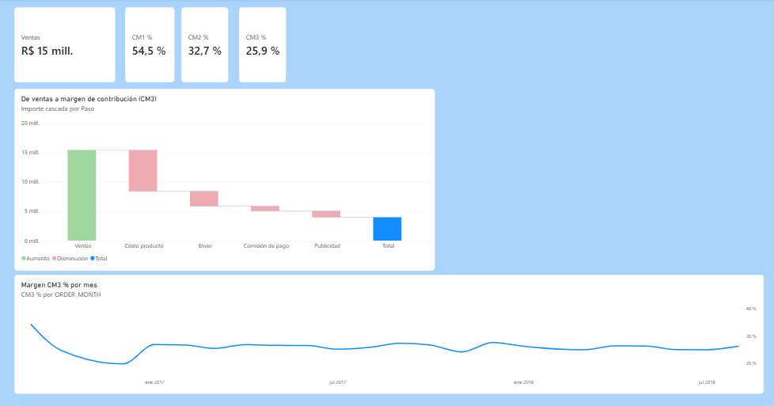
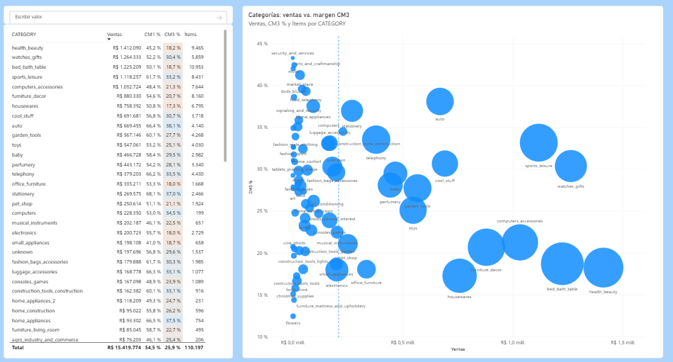
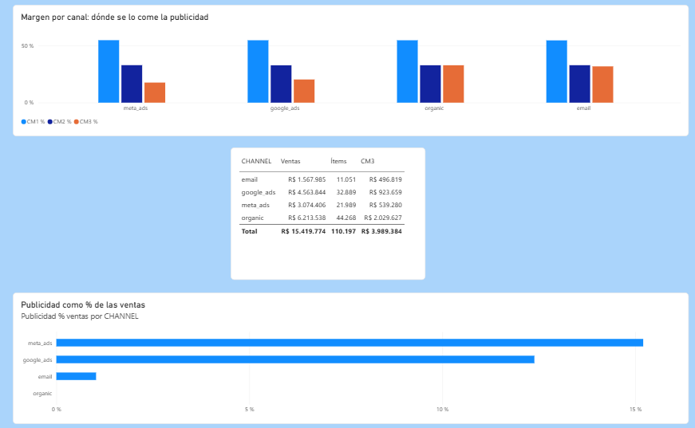
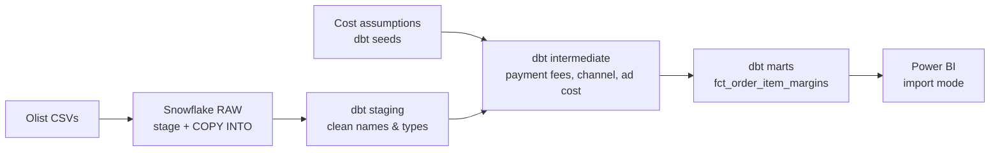

# E-commerce Profitability: contribution margin by product and channel

**Which products and channels actually make money once every cost is counted?** This project turns raw e-commerce orders into a tested contribution-margin model (CM1, CM2, CM3) and a Power BI dashboard that answers that question at a glance.



Built with **Snowflake, dbt, Python and Power BI**. The same dbt model also runs on **DuckDB** with identical results, so anyone can reproduce it for free.

---

## The problem

Most e-commerce reports stop at revenue. A product that sells a lot can still lose money after product cost, shipping, payment fees and the ads that brought the customer in. This model follows every order item from revenue down to the margin left after marketing:

| Level | Calculation | Question it answers |
| --- | --- | --- |
| **CM1** | Revenue − product cost | Does the product have a margin at all? |
| **CM2** | CM1 − shipping − payment fees | Is it still profitable once delivered and paid? |
| **CM3** | CM2 − allocated advertising | Is it worth paying to sell it? |

## What contribution margin means

**Contribution margin** is the money each sale leaves after paying the costs that exist *because* of that sale. It is what "contributes" to covering fixed costs (rent, salaries, software) and, after that, to profit. Splitting it into three levels shows exactly where the money goes:

- **CM1, product margin.** Revenue minus the cost of the product itself. It tells you whether the product is priced well relative to what it costs to buy or make. A low CM1 is a pricing or sourcing problem. *In this project:* revenue is what the customer paid for the item (price + freight), and product cost is a percentage of the price set per category.

- **CM2, margin after fulfillment.** CM1 minus the variable costs of delivering and collecting the order. It tells you whether the sale is still profitable once the product reaches the customer and the money reaches the bank. A product can look great at CM1 and collapse here if it is heavy, cheap or often paid in many installments. *In this project:* shipping cost (what the carrier charges the store) and payment fees (by payment method, with a surcharge per credit-card installment).

- **CM3, margin after marketing.** CM2 minus the advertising spent to win the sale. It tells you whether it is worth paying to acquire that customer. It is the level that separates channels: the same product sold through organic search and through paid ads has the same CM2 but a very different CM3. *In this project:* ad cost as a share of revenue for the order's acquisition channel and month.

How to read them together: **CM1 is about the product, CM2 about operations, CM3 about marketing.** When a margin drops sharply between two levels, that is where to look first.

## Key findings

Based on 110,197 items from 96,478 delivered orders (Sept 2016 – Aug 2018):

- **Overall:** R$ 15.4M in revenue, CM1 54.5%, CM2 32.7%, CM3 25.9%.
- **Advertising decides the channel ranking.** All channels share the same CM1 and CM2; paid channels lose up to 15.2 points of margin at CM3. Meta Ads ends at 17.5% vs. 32.7% for organic.
- **Best sellers are not the most profitable.** Health & beauty, bed/bath/table and housewares are among the top categories by revenue but sit well below the average CM3.
- **Payment reconciliation flagged 247 of 96,478 delivered orders (0.26%)** where the amount collected does not match the amount billed: 229 overcharged (installment interest, surcharges), 17 undercharged (vouchers) and 1 with no payment recorded.

| Product view | Channel view |
| --- | --- |
|  |  |

## How it works



| Layer | Models | What happens |
| --- | --- | --- |
| Staging | `stg_olist__*` (6 views) | Rename, cast, build keys. No business logic. |
| Intermediate | `int_order_payment_fees`, `int_order_channel`, `int_ad_cost_allocated` | Payment fees split across items by price; simulated acquisition channel; ad cost by channel and month. |
| Marts | `fct_order_item_margins`, `dim_products`, `dim_customers` | One row per delivered order item with revenue, every cost and CM1–CM3. |

## Data quality

40+ dbt tests run on every build, including four business tests:

| Test | What it checks |
| --- | --- |
| `assert_payments_reconcile_with_items` | Per delivered order, money collected equals money billed. Set to **warn**: differences come from the source and are reported, not hidden. |
| `assert_payment_fee_allocation_closes` | Splitting fees across items neither loses nor creates money. |
| `assert_fct_revenue_matches_staging` | Joins in the mart do not drop or duplicate items. |
| `assert_margins_close` | Every margin level ties out to its components. |

## Cost control

Snowflake is set up so a portfolio project can never produce a surprise bill: an X-Small warehouse with 60-second auto-suspend and a resource monitor that notifies at 80% and suspends at 100% of a 10-credit quota. Power BI uses import mode, so dashboard filters do not consume credits. **Total consumption: 0.20 credits.**

## Assumptions

Olist publishes prices, freight and payments, but not the store's costs. Product cost, payment fees, acquisition channel and ad spend are **simulated with explicit, documented assumptions** stored as dbt seeds. Swapping in a real client's numbers means editing one place and rerunning `dbt build`.

See [docs/assumptions.md](docs/assumptions.md) for every value and the reasoning behind it, and [docs/decisions.md](docs/decisions.md) for the technical decisions made along the way.

## Run it yourself

**Free option, DuckDB (no account needed):**

```bash
git clone https://github.com/GianCipollari/ecommerce-margins.git
cd ecommerce-margins
python -m venv .venv && .venv\Scripts\activate      # Windows
pip install -r requirements.txt
# Download the dataset from Kaggle into data/raw (see below)
python scripts/generate_seeds.py
dbt build --target duckdb
```

**Snowflake:** run `scripts/01_setup.sql`, upload the CSVs to the stage and run `scripts/02_load_raw.sql`, then `dbt build`.

Data: [Brazilian E-Commerce Public Dataset by Olist](https://www.kaggle.com/datasets/olistbr/brazilian-ecommerce). Place the CSVs in `data/raw/` (geolocation and reviews are not used). The data folder is not versioned.

A dbt profile named `ecom_margins` with a `dev` (Snowflake) and a `duckdb` target is required in `~/.dbt/profiles.yml`.

## Project structure

```
├── dashboard/        Power BI file (.pbix)
├── docs/             Assumptions, technical decisions, screenshots
├── macros/           Cross-database helpers (Snowflake / DuckDB)
├── models/
│   ├── staging/
│   ├── intermediate/
│   └── marts/
├── scripts/          Snowflake setup and load, seed generator, engine comparison
├── seeds/            Cost assumptions
└── tests/            Business tests
```

## Limitations

- Absolute margins depend on the simulated costs. The model demonstrates the logic (which costs enter each margin level and how they are allocated), not Olist's real profitability.
- The acquisition channel is simulated, so channel differences reflect the advertising assumptions rather than real customer behavior.

---

**Gianfranco Cipollari** · Revenue & profitability data engineer · [LinkedIn](https://www.linkedin.com/in/gianfranco-cipollari-b61a982b4/) · [GitHub](https://github.com/GianCipollari)
